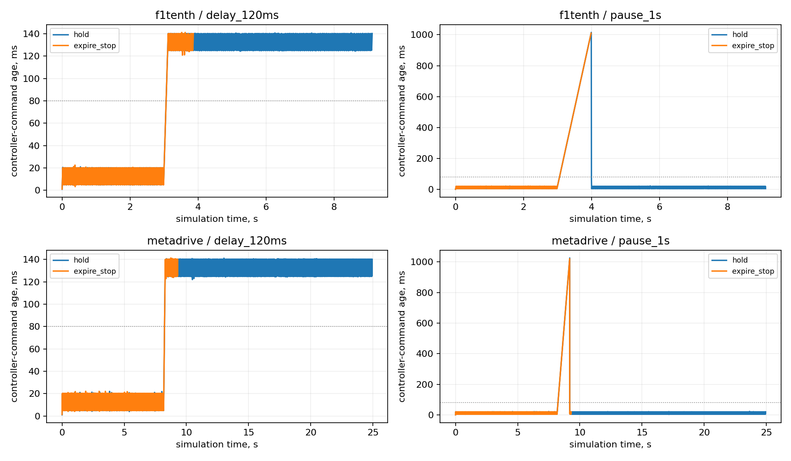
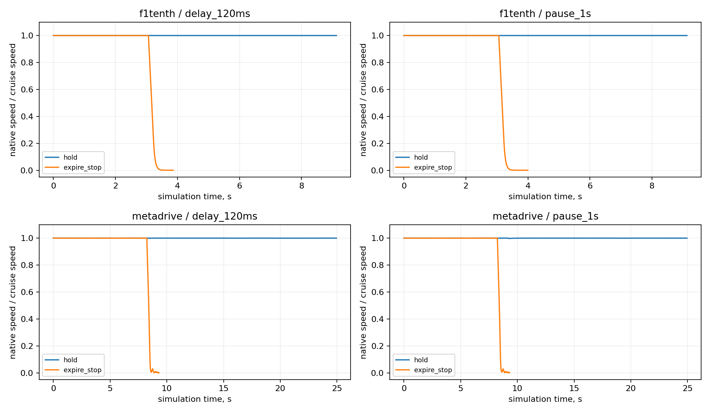
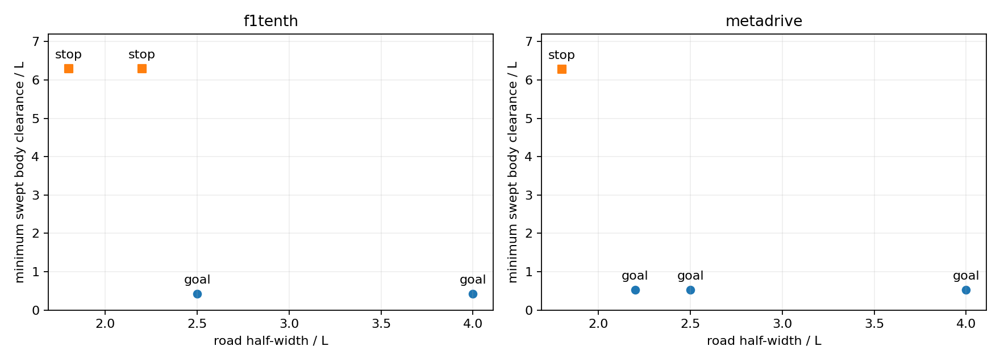

# Outcome and scope

Executed batch `focus40_20261029_01`: 40 planned cases; 40 valid independent case audits.

The three questions were whether the planner changes task completion relative to stopping-only control, how asynchronous command delivery and expiry change outcomes, and where a fixed candidate planner rejects a narrower road. These are exploratory finite-case results, with two development seeds in the matched comparisons and one in the other groups. Adverse outcomes are retained. No real-world safety or statistical robustness claim is made.

# Matched comparison results

| Backend | Task | Variant / transport | Goals | Stops | Other outcomes |
| --- | --- | --- | ---: | ---: | --- |
| f1tenth | detour | Stopping only / local | 0/2 | 2/2 | None |
| f1tenth | detour | Planner / local | 2/2 | 0/2 | None |
| f1tenth | detour | Planner / async DDS | 2/2 | 0/2 | None |
| f1tenth | blocked | Stopping only / local | 0/2 | 2/2 | None |
| f1tenth | blocked | Planner / local | 0/2 | 2/2 | None |
| f1tenth | blocked | Planner / async DDS | 0/2 | 2/2 | None |
| metadrive | detour | Stopping only / local | 0/2 | 2/2 | None |
| metadrive | detour | Planner / local | 2/2 | 0/2 | None |
| metadrive | detour | Planner / async DDS | 2/2 | 0/2 | None |
| metadrive | blocked | Stopping only / local | 0/2 | 2/2 | None |
| metadrive | blocked | Planner / local | 0/2 | 2/2 | None |
| metadrive | blocked | Planner / async DDS | 0/2 | 2/2 | None |

Goal completion and collision-free stopping are different outcomes. The stopping-only variant deliberately has no detour planner; it can correctly stop for a feasible obstacle while failing to reach the route goal. All variants share their respective map, speed setting, noise seed, tracking controller and stopping rule. The transport comparison uses the same planner and authority rules, but in-process execution is unpaced and asynchronous DDS execution is wall-paced. Differences cannot be attributed to isolated middleware latency alone.

# Fault and command-policy results

| Backend | Fault | Policy | Outcome | Minimum clearance / L | Max command age, ms | Max start lag, ms |
| --- | --- | --- | --- | ---: | ---: | ---: |
| f1tenth | Delay 120 ms | Hold | Goal | 0.3952 | 140.7 | 3.4 |
| f1tenth | Delay 120 ms | Expiry stop | Stopped | 6.9559 | 141.2 | 4.6 |
| f1tenth | Pause 1 s | Hold | Goal | 0.2855 | 1015.0 | 6.9 |
| f1tenth | Pause 1 s | Expiry stop | Stopped | 6.9859 | 1010.1 | 3.5 |
| metadrive | Delay 120 ms | Hold | Goal | 0.5213 | 141.2 | 3.8 |
| metadrive | Delay 120 ms | Expiry stop | Stopped | 7.5374 | 141.3 | 4.7 |
| metadrive | Pause 1 s | Hold | Goal | 0.5257 | 1025.1 | 4.2 |
| metadrive | Pause 1 s | Expiry stop | Stopped | 7.5375 | 1020.3 | 2.9 |

The age shown is the latest controller command's age at arbitration, before the speed override. It is not the age of the supervisor's newly generated zero-speed decision. The corresponding native-speed response is shown below.

Delayed replies receive 120 ms of added wall-time delay. The isolated controller process is paused with SIGSTOP and resumed with SIGCONT after one wall second. Faults begin when native progress reaches x=18L; that progress is an injection/scoring input and is not available to the controller. Command expiry is based on application monotonic time minus the source request time. Expire-stop latches a zero target speed once that age exceeds 80 ms; steering remains controller-selected. Hold continues using the latest accepted sequence-numbered command. A zero target is not an instantaneous physical stop. The 80 ms value applies to command-source age here; the original paper's 80 ms observation-freshness check is a different diagnostic. The fixed wall-time faults represent different travel distances in wheelbases across the plants, so their responses do not rank simulator quality.

# Fixed-planner road-width boundary

| Backend | Road half-width / L | Planner requires stop | Outcome | Minimum clearance / L |
| --- | ---: | --- | --- | ---: |
| f1tenth | 4 | No | Goal | 0.4256 |
| f1tenth | 2.5 | No | Goal | 0.4256 |
| f1tenth | 2.2 | Yes | Stopped | 6.2946 |
| f1tenth | 1.8 | Yes | Stopped | 6.2946 |
| metadrive | 4 | No | Goal | 0.5261 |
| metadrive | 2.5 | No | Goal | 0.5261 |
| metadrive | 2.2 | No | Goal | 0.5261 |
| metadrive | 1.8 | Yes | Stopped | 6.2828 |

This is the boundary of the fixed candidate set and screening margins, not a proof that no other planner could pass. Road half-width is varied while obstacle size and native body geometry remain fixed within each backend. Body dimensions differ after wheelbase normalization, so a cross-backend decision difference does not rank simulator fidelity.

# Implementation and independent checks

The campaign protocol was written before execution. A source snapshot and matrix were frozen in the batch folder. All native physics steps, synthetic observations, source requests, received replies, applied commands, fault events and both clock domains were retained. The original package was mounted read-only and the paper was not edited.

The DDS nodes ran in separate processes inside one container on one host,
using Fast DDS. Transport may use shared memory. This is a process-boundary
and application-timing experiment, not a measurement of a physical network link.

A separate standard-library audit reconstructs body clearance with separating axes and segment distances at retained endpoints and interval midpoints. It checks terminal goals/stops, conservative swept clearance, reply timestamp order and injected-delay timing. It independently reconstructs every command-age expiry and latched zero-speed override. Online checks compare every DDS command with the shared controller evaluated at that request's recorded source estimate. This is command-transport equivalence, not an independent implementation of the planner.

Four policy/geometry unit checks and three asynchronous F1TENTH development runs preceded the campaign. Their outputs are separate and excluded from the 40-case count. The development pause/hold case reached the goal while pause/expiry stopped; this informed the interpretation of intervention as a measured trade-off rather than an assumed universal improvement.

# Timing limits and interpretation

Across the 16 asynchronous cases, maximum recorded event-start lag was 6.9 ms. 0 cases had at least one event start more than 20 ms behind the requested simulation/wall-time schedule.

The separate nominal F1TENTH development run recorded a 31.0 ms maximum
event-start lag. It remains preserved in `focus_development_01` and is not
included in the 40-case campaign. This scheduling variability is another
reason not to infer a general deadline guarantee from the final batch.

The runner continues physics without waiting for a reply; clock pacing is nevertheless limited by host scheduling and computation. Report the retained pacing lag and elapsed wall/simulation times before asserting a real-time deadline. This experiment measures an entire Python/ROS/application path, not isolated DDS transport performance, and does not compare middleware vendors.

Obstacles are known static geometric exclusion regions. Candidate planning occurs once at setup. There is no native perception, online replanning, impact response or physical-vehicle counterpart. Initial stopped-state clearance is deliberately generous. These are not sudden-emergency braking tests. The finite sample sizes cannot support road-level collision probabilities or general robustness guarantees.

# Evidence and next decisions

The recorded outcomes are 17 goal completions and 23 stops. No obstacle
collision or road departure was scored, and all 40 cases met the 0.25L
clearance gate. This does not make 40 independent safety trials.

For the paper, the strongest supported conclusions are:

- Planning changes the feasible-detour outcome: 4/4 goals with the in-process
  planner versus 0/4 with stopping-only control; the latter stopped in all four.
- The asynchronous DDS implementation completed all four nominal detours and
  stopped in all four nominal blocked cases, matching their in-process task
  outcomes under the selected conditions.
- Expiry-stop followed its authority rule under both tested faults in both
  backends, while hold also completed these selected routes. The experiment
  does not demonstrate that expiry-stop prevented a collision that hold caused.
- F1TENTH's one-second pause/hold case retained about 0.2855L clearance, versus
  about 0.426L in its nominal asynchronous case for the same seed. This is a
  selected-case sensitivity observation, not a population estimate.
- The width sweep exposes a plant/body-dependent fixed-planner decision
  boundary, supporting explicit adapter/geometry contracts and reported limits.

Draft wording for later manuscript review, without editing the paper:

> A further focused development campaign compared stopping-only control,
> candidate-path planning and asynchronous ROS 2/DDS execution across two
> native simulated plants. Twenty-four matched cases examined task completion,
> eight cases exercised delayed replies or controller-process interruption
> under hold/expiry policies, and eight cases varied road width. Physics
> continued while replies were absent. Independent reconstruction checked
> command-age authority and whole-body geometric outcomes. Planning enabled
> the selected feasible detours, while expiry-stop produced conservative
> interventions and the width sweep exposed limits of the fixed candidate
> planner. These finite development results do not establish statistical
> robustness, isolated middleware performance or real-world safety.

The presentation figures were regenerated outside the frozen batch to improve
label spacing and clarify that age is measured at controller-command arbitration.
The frozen plots and their original labels remain in the evidence payload;
raw data and source hashes were not changed.

The authoritative raw batch is `ros2_visual_lab/artifacts/focus40_20261029_01/`. See `manifest.json`, `frozen_source/`, `summary.json`, `RESULTS.md`, each `independent_audit.json`, raw compressed CSV files, `source_integrity.json` and `output_hashes.json`. The image ID and console output are stored alongside the batch folder. This narrative is a derived post-campaign report; the frozen case matrix and sources remain unchanged.

Before paper transfer, review each outcome, check pacing exceptions, and decide whether the matched application comparisons are sufficient or whether a matched wall-paced in-process baseline is also needed. A formal repeated campaign should use new frozen seeds and explicit effect/uncertainty requirements. Do not tune on these cases and then describe the same outcomes as held-out validation.

The original 864 runs remain the original in-process study. These new results require their own methods, scope, run counts and explicit speed-command authority. All manuscript text remains unchanged pending review.
