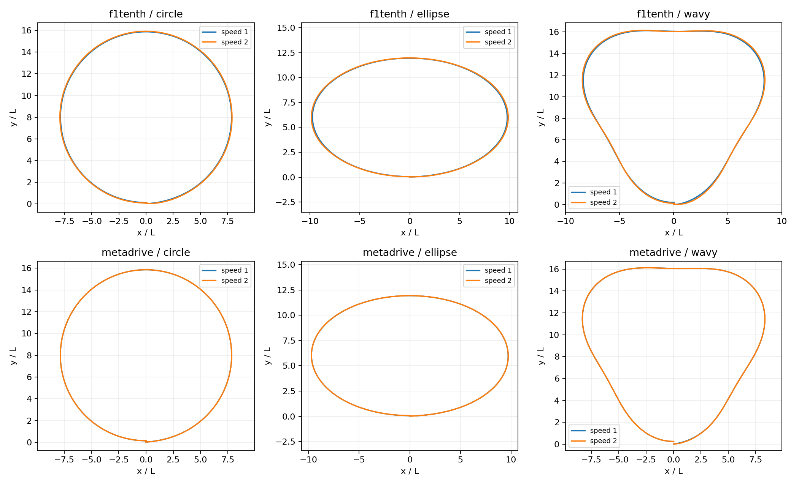
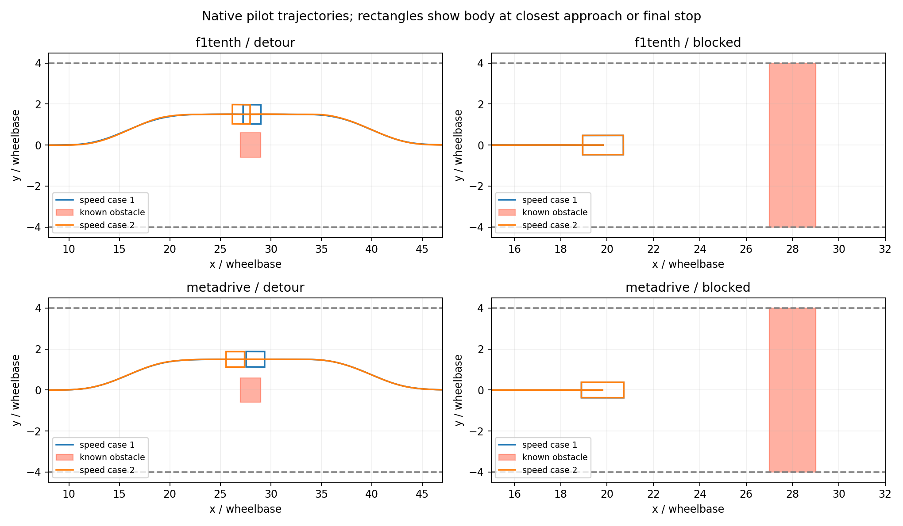

# Outcome

The requested sequential batch completed: **20/20 pilot gates passed**.
Twelve geometry circuits completed, four mapped-obstacle detours reached the
goal, and four blocked-route cases stopped. No obstacle collision or road
departure was scored in these cases. The paper and original package remain
unchanged. These are new development records, outside the original 864 runs.

| Family | F1TENTH | MetaDrive | Total |
| --- | ---: | ---: | ---: |
| Circle, ellipse, wavy at two speeds | 6/6 | 6/6 | 12/12 |
| Static-map detour at two speeds | 2/2 | 2/2 | 4/4 |
| Anticipated blocked-route stop at two speeds | 2/2 | 2/2 | 4/4 |
| All pilot gates | 10/10 | 10/10 | 20/20 |

# Execution and preservation

Command: `bash ros2_visual_lab/run_pilots.sh pilot20_20261029_01`.

The local shell wrapper runs one case after another inside the existing Docker
image. Each native runner has a separate ROS 2 controller process. Fast DDS
uses isolated domain 74, with reliable/volatile/depth-10 prototype messages.
The matrix and source hashes were captured before execution. The original
data/code is mounted read-only. The image ID and console log are retained.

All cases use development seed 1001 and the two original speed settings:
1/2 m/s for F1TENTH, approximately 2.734/5.469 m/s for MetaDrive. Native
physics steps remain 1 ms and 5 ms, respectively. Geometry cases retain the
original observation/prediction/monitor loop. The new obstacle loop uses
synthetic noisy pose/speed observations and fixed-gain state correction, with
separate path selection and speed-command authority. The original yaw monitor
is not claimed to diagnose the new obstacle scenarios.

Execution was headless, unpaced and **lockstep**. Simulation waits for the
controller response. No asynchronous deadline or physical-network conclusion
is drawn from these runs.

Four collision/planning correctness tests passed before execution: corner
overlap with a clear reference point, thin-obstacle crossing between samples,
rotation between samples, and feasible-detour/blocked-route behaviour. Four
separate preliminary F1TENTH native obstacle checks passed in
`obstacle_development_01`; they are excluded from the 20-case count.

After the batch, all frozen source hashes and output hashes verified. The
manuscript checksum remained unchanged, and the complete delivered package
verifier passed again. The verification output is saved beside this report.

# Geometry results

All circuits completed without a sampled reference-position corridor failure.
Tracking RMSE was independently recomputed from the retained tracking-error
column and agreed with the native run summary. Every DDS steering command
and path index matched the shared local controller calculation.

| Backend | Path | Speed case | Tracking RMSE / L |
| --- | --- | ---: | ---: |
| F1TENTH | Circle | 1 | 0.119370 |
| F1TENTH | Circle | 2 | 0.073400 |
| F1TENTH | Ellipse | 1 | 0.134730 |
| F1TENTH | Ellipse | 2 | 0.078000 |
| F1TENTH | Wavy | 1 | 0.136404 |
| F1TENTH | Wavy | 2 | 0.085607 |
| MetaDrive | Circle | 1 | 0.143659 |
| MetaDrive | Circle | 2 | 0.142216 |
| MetaDrive | Ellipse | 1 | 0.164790 |
| MetaDrive | Ellipse | 2 | 0.157818 |
| MetaDrive | Wavy | 1 | 0.164126 |
| MetaDrive | Wavy | 2 | 0.172340 |

The speed-dependent differences are observations from one development seed;
they are not a general monotonic speed law or a ranking of simulator accuracy.
There was no separate in-process native rerun for every geometry case in this
20-case budget; the local calculation verifies each transported command,
rather than establishing matched closed-loop performance superiority.



# Obstacle methods and results

Obstacles are **known static geometric exclusion regions** supplied by the
scenario map. They are not detected through native LiDAR/cameras, and native
impact response is not modelled. The same geometric map defines the planner's
obstacle and the independent scorer's exclusion region.

The road extends along x with half-width 4L. The feasible-detour obstacle
occupies x=27L to 29L and y=-0.6L to +0.6L. A small candidate-path planner
checks smooth lateral offsets against curvature, road boundaries and vehicle
footprint clearance, then selects a valid route once at startup. Both plants
selected a +1.5L detour. Pure pursuit tracks that route from estimated pose,
and success requires reaching x=55L with at least 0.25L swept body clearance.
This is initial map-based route selection, not online obstacle replanning.

The blocked case occupies the entire road width. It rejects the candidate
detours, retains the centreline, and issues an authorised decreasing speed
target toward x=20L. A passing stop requires speed below 0.03 times the
backend time-scale factor for at least 0.5 simulated seconds, zero requested
speed, no collision/departure and the same clearance gate. The barrier is
known from the start: this is an anticipated stop, not emergency braking.

| Backend | Scenario | Speed case | Outcome | Min. swept body clearance / L |
| --- | --- | ---: | --- | ---: |
| F1TENTH | Detour | 1 | Goal reached | 0.427496 |
| F1TENTH | Detour | 2 | Goal reached | 0.430182 |
| F1TENTH | Blocked | 1 | Stopped | 6.295673 |
| F1TENTH | Blocked | 2 | Stopped | 6.294844 |
| MetaDrive | Detour | 1 | Goal reached | 0.525730 |
| MetaDrive | Detour | 2 | Goal reached | 0.523753 |
| MetaDrive | Blocked | 1 | Stopped | 6.278187 |
| MetaDrive | Blocked | 2 | Stopped | 6.279595 |

Detour clearance corresponds to approximately 0.141–0.142 m for F1TENTH and
1.293–1.298 m for MetaDrive. These different physical margins are a consequence
of the scale/body mapping and should not be interpreted as equivalent risk.



The production scorer uses the native body length and width as a symmetric
oriented rectangle. It retains every native physics step and forms a
conservative swept region between successive poses under a linear-centre,
shortest-yaw interpolation assumption, including a rotational allowance.
Road-boundary clearance is scored for the entire swept rectangle.

A separate standard-library audit reconstructs rectangles, uses separating
axes and segment distances, and checks retained endpoints and interval
midpoints. It independently confirms clearance and the goal/terminal-stop
outcome for all eight obstacle cases. Its reconstructed minimum distances
are consistent with the production swept score being conservative. This
complements the swept check; neither method is a claim of exact continuous
native-contact dynamics.

The recorded obstacle estimate fields are the estimate available at the start
of the 5 ms event, held while its native substeps are logged. They must not be
treated as a fully source-aligned state-estimation benchmark at each substep.
The pilot conclusions use native body geometry, trajectory and commands.

# Timing and what the pilot establishes

Per-case p95 application round trips ranged from approximately 0.545 to
0.925 ms across the batch. This includes Python serialization, executor work,
the controller and DDS. The first obstacle exchange can include candidate
planning. There is no new middleware ranking or real-time guarantee.

The pilot adds evidence that the shared controller interface operates through
DDS on three geometries, and that the new map-based candidate-path/speed
functions can steer the two native plants around the selected obstacle or
stop for the blocked road. It also establishes inspectable body-clearance
scoring for these cases, beyond the original reference-position corridor.

It does not establish robustness across noise seeds, unseen roads, moving
objects, perception error, short-notice braking, combined faults or actual
network outages. There is no baseline-vs-avoidance superiority comparison,
no asynchronous physics during message delays and no real-world safety result.
All 20 outcomes remain one-seed development results.

# Proposed wording for later manuscript transfer

> A supplementary development pilot exercised separate ROS 2/DDS controller
> processes with native F1TENTH and MetaDrive plants. Twelve runs covered
> circle, ellipse and wavy paths at two speed settings. Eight further runs
> evaluated known-static-map detours and anticipated stopping for a blocked
> route, using candidate path selection, explicit speed-command authority and
> whole-body geometric clearance scoring. All selected pilot cases met their
> prespecified development gates, and separate geometry audits confirmed the
> obstacle outcomes. Execution was lockstep with one development seed; these
> results demonstrate the implemented functions in selected cases, without
> establishing perception performance, asynchronous deadlines or statistical
> robustness.

This wording is logged for review only. The current 864-run paper section
must remain identified as the original in-process study. The new speed
supervisor also needs an explicit architecture/control-authority description
if included in a later article revision.

# Rerun, evidence and next step

Launch a new complete batch from the project root:

```bash
bash ros2_visual_lab/run_pilots.sh my_pilot_batch_02
```

Use a fresh label. The wrapper runs all cases sequentially, continues after a
case failure, generates summaries/plots/audits, and returns nonzero if a gate
or process fails. Outputs are not silently overwritten.

Evidence under `ros2_visual_lab/artifacts/pilot20_20261029_01/` includes the
frozen manifest, execution register, `pilot_summary.json`, `RESULTS.md`, source
and output hashes, scenario definitions, selected paths, native physics and
observation logs, command timing and eight independent obstacle audits.
The image ID and console log sit beside the batch folder. The post-pilot
original-package check is `reports/pilot20_package_verification.json`.

The next justified milestone is a matched stopping-only/planner comparison
and a verified asynchronous command-expiry policy, initially in a small
representative subset. The larger proposed 144+48-run extension should not
be launched unchanged until those behaviours and their acceptance thresholds
are frozen. More scenery or another repetition of the same seed would not
resolve those gaps.
